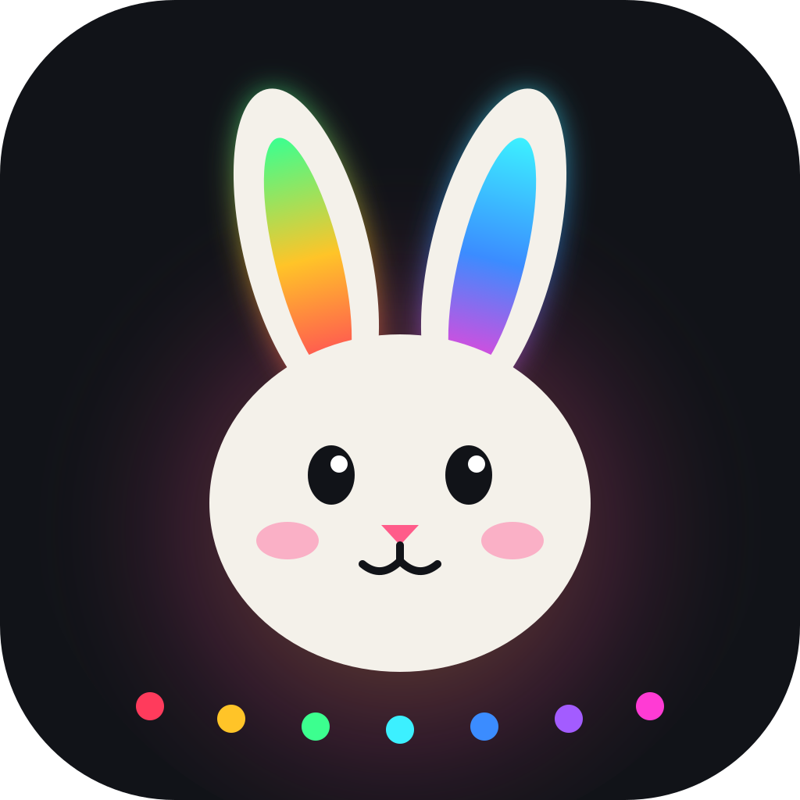

# Lamps

Control Bluetooth LED lights without the manufacturers' apps: **ELK-BLEDOM / MELK LED sticks** and the **Hello Fairy 20×20 curtain** (sold at Action). It runs on an Android phone and on a Windows PC.

## Install

### Android

1. On your phone, open the **[latest release](../../releases/latest)**.
2. Download **Lampes.apk** and open it. If Android asks, allow "install unknown apps".
3. On first launch, accept the permissions: nearby devices (Bluetooth) and microphone (music mode).

New versions install over the old one and keep your settings.

### Windows PC

1. From the **[latest release](../../releases/latest)**, download **Install-Lamps.cmd**.
2. Double-click it. It installs the app for Chrome or Edge and adds a **Lamps** shortcut on the desktop and in the Start menu.
3. Run it again later to update. Your lamps and settings are kept.

Drawing a picture on the curtain in one go needs the phone: the PC's Bluetooth sends packets that are too small for it.

## Features

- **Lamps and groups:** connect several lamps, control them all at once or by group (*All*, *Sticks*, *Curtain*, or your own groups). They reconnect automatically, and a watchdog reconnects a lamp that stops answering.
- **Colour and brightness:** colour wheel, swatches, white, on/off.
- **✨ Animation:** choose your own colours, then a mode: Fixed, Jump, Fade, Rainbow (with a direction switch), Breathe, Flash or Strobe.
- **Built-in animations:** the lamps' own effects, grouped by theme. For the curtain: Christmas, Halloween, Love, Clover, Beer and Flags.
- **Curtain animations drawn by the app:** fireworks, retro games (Matrix rain, Snake, Invaders, Falling blocks), a clock, a colour wheel disc, a campfire and lava, plus your own finger drawing.
- **🎵 Music mode:** lights follow the music, including the curtain as a live spectrum. On the phone it listens to the sound of other apps like Tidal or Spotify. On the PC it listens to Voicemeeter or to system sound.
- **🎬 Ambilight:** lamps take the dominant colour of the screen, either the phone's or the PC's.
- **⏰ Timer and sunrise alarm:** fade out to sleep, or wake up to a sunrise.
- **Favourites and scenes** per tab, and the app keeps running in the background on the phone.

## Repository

| Path | What it is |
|---|---|
| `web/lampes-bt.html` | The whole app, one page shared by the PC and Android |
| `android/` | Android shell: shows the page, native Bluetooth (512-byte packets), phone sound analysis, screen capture |
| `pc/installer-head.cmd` | Windows installer template (the page is appended to it at build time) |
| `.github/workflows/apk.yml` | Every push to `main` builds the APK and the PC installer and publishes them as a release |

## Credits

The curtain protocol is based on [nzrutman/hello_fairy_ble](https://github.com/nzrutman/hello_fairy_ble) and [yamatt/curtains](https://github.com/yamatt/curtains). The MELK sticks protocol is based on [dave-code-ruiz/elkbledom](https://github.com/dave-code-ruiz/elkbledom).
